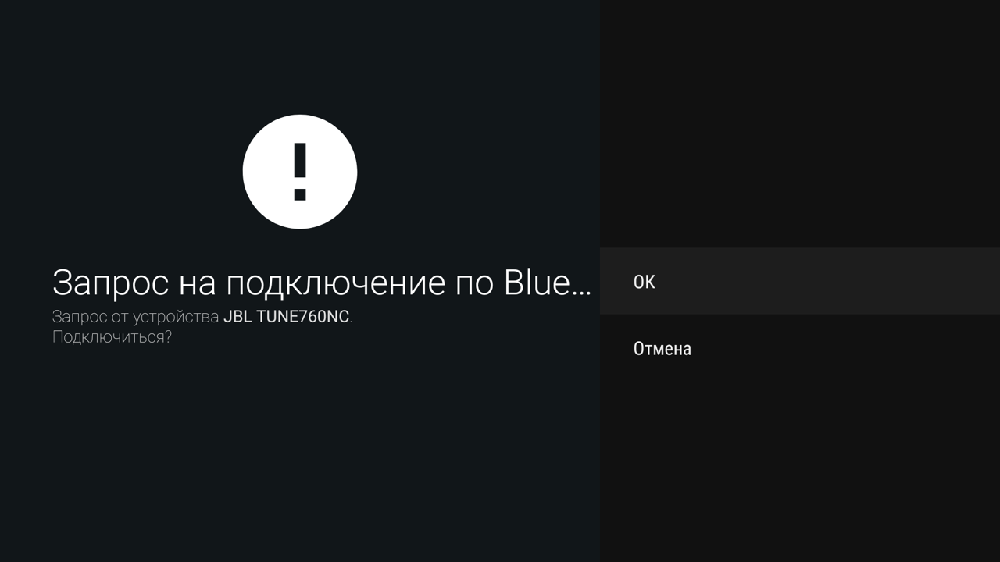
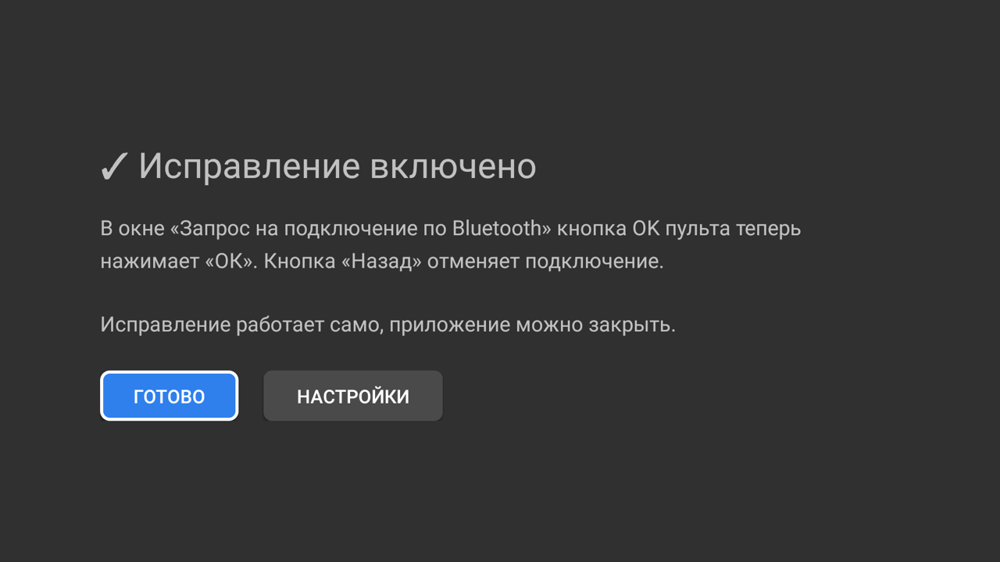
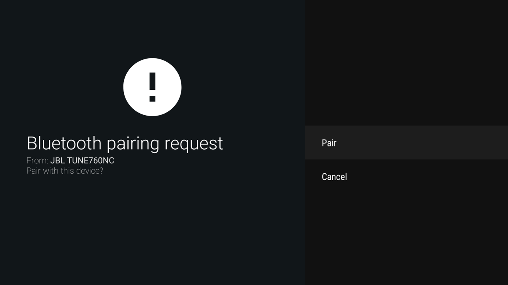
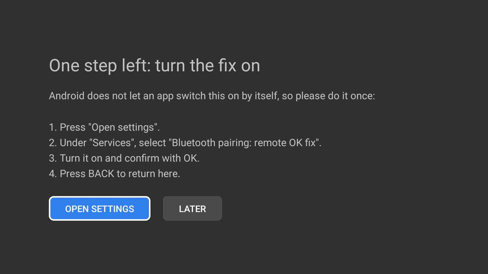

# Xiaomi TV: кнопка OK пульта в окне сопряжения Bluetooth

[English below](#english)

Бесплатное приложение с открытым кодом. Исправляет известную ошибку телевизоров Xiaomi на Android TV: при подключении Bluetooth-наушников или колонки в окне «Запрос на подключение по Bluetooth» кнопка OK пульта не работает, и приходится подключать мышь, чтобы нажать «ОК».



**Скачать:** [bt-pairing-fix.apk](https://github.com/dedmazzay/xiaomi-tv-bt-pairing-fix/releases/latest/download/bt-pairing-fix.apk) (последняя версия, около 35 КБ).

## Установка с флешки — без компьютера и без режима разработчика

Понадобятся флешка и компьютер или телефон, чтобы скачать на неё файл. Всё остальное делается пультом.

1. **Скачайте** [bt-pairing-fix.apk](https://github.com/dedmazzay/xiaomi-tv-bt-pairing-fix/releases/latest/download/bt-pairing-fix.apk) и скопируйте его в корень флешки.
2. **Вставьте флешку** в USB-разъём телевизора.
3. **Откройте «Медиаплеер».** На главном экране это плитка MEDIA PLAYER, в списке приложений — «Проигрыватель».
4. Вкладка **«Устройства»** → ваша флешка → **bt-pairing-fix.apk** → кнопка OK.
5. В окне установки выберите **«Установить»**, затем **«Открыть»**.
   Если телевизор пишет, что установка из неизвестных источников заблокирована: выберите «Настройки», включите переключатель у «Проигрыватель», нажмите «Назад» и снова откройте файл.
6. Откроется приложение «Bluetooth: OK с пульта». Нажмите **«Открыть настройки»**.

7. Откроются «Специальные возможности». В разделе **«Сервисы»** выберите **«Bluetooth: OK с пульта»** → **«Включить»** → в предупреждении **«ОК»**.
8. Нажмите **«Назад»**. Приложение покажет **«✓ Исправление включено»**. Готово, флешку можно вынуть.

   

Предупреждение на шаге 7 — стандартный текст Android для любой службы специальных возможностей: «может сохранять любой вводимый текст». Это приложение не сохраняет введённый текст, и у него нет разрешения на доступ в интернет (см. «Безопасность»).

## Установка через компьютер — от режима разработчика до результата

Подходит, если флешки нет или «Медиаплеер» не открывает APK.

**На телевизоре:**

1. «Настройки» → «Настройки устройства» → «Об устройстве» → пункт **«Сборка»**: нажмите OK **7 раз подряд**, пока не появится «Вы стали разработчиком».
2. «Назад» → в «Настройках устройства» появится **«Для разработчиков»** → **«Отладка по USB»** → ВКЛ. На проверенном P1 этот же переключатель открывает отладку и по сети; на других прошивках это не проверено.
   Пункт «Factory Menu» в этом разделе — заводское меню, его не трогайте.
3. «Настройки» → «Настройки устройства» → «Об устройстве» → «Статус» либо «Сеть и Интернет» → ваше подключение: запишите **IP-адрес** телевизора, например `192.168.1.50`.

**На компьютере** (компьютер и телевизор в одной домашней сети):

4. Скачайте [официальные SDK Platform-Tools для Windows, macOS или Linux](https://developer.android.com/tools/releases/platform-tools), распакуйте архив и откройте терминал в папке `platform-tools`. Android Studio не нужна. В примерах ниже `adb` должен быть в `PATH`; иначе на macOS/Linux используйте `./adb`, а в Windows PowerShell — `.\adb.exe`. Проверьте запуск командой `adb version`. Справка: [Android Debug Bridge](https://developer.android.com/tools/adb).

5. Подключитесь (подставьте свой IP):

   ```bash
   adb connect 192.168.1.50:5555
   ```

   На телевизоре появится «Разрешить отладку?»: отметьте «Всегда разрешать с этого компьютера» и нажмите «ОК». Если `adb` пишет `unauthorized`, повторите команду после подтверждения. Выполните `adb devices`: перед установкой телевизор должен отображаться со статусом `device`.
6. Скачайте APK по ссылке выше. Установите приложение (файл должен лежать в текущей папке; `-r` обновляет установленную копию с той же подписью):

   ```bash
   adb install -r bt-pairing-fix.apk
   ```

7. Откройте «Bluetooth: OK с пульта» в списке приложений телевизора. Нажмите «Открыть настройки» → «Специальные возможности» → «Сервисы» → «Bluetooth: OK с пульта» → «Включить» → «ОК». Нажмите «Назад» и убедитесь, что приложение показывает «✓ Исправление включено». Android не разрешает приложению включить службу автоматически; этот шаг выполняется вручную.

8. По желанию после установки выключите «Отладку по USB» обратно: для работы исправления она не нужна.

В версии **1.1.0** появился экран приложения с состоянием службы, баннером для списка приложений Android TV и заметным выделением кнопки в фокусе пульта.

## Проверка

«Настройки» → «Пульты и аксессуары» → «Добавить аксессуар» → переведите наушники в режим сопряжения и выберите их. В окне «Запрос на подключение по Bluetooth» нажмите **OK на пульте**: наушники подключатся. «Назад» в этом окне отменяет подключение.

## В чём ошибка

Пункт «ОК» на экране выглядит выделенным, но фокуса на нём нет. Фокус стоит на заголовке окна, а кнопки «ОК» и «Отмена» сделаны так, что фокус на них не переходит никогда. Нажатие OK уходит в заголовок, и система его отбрасывает:

```
WindowManager: Unhandled key: win=...BluetoothPairingDialog, keyCode=23 (DPAD_CENTER)
```

Стрелки фокус тоже не двигают. Через 30 секунд окно закрывается и отменяет сопряжение. Мышь работает, потому что нажимает кнопку напрямую. Пульт тут ни при чём: нажатия до телевизора доходят. Ошибка в окне `com.android.tv.settings/.accessories.BluetoothPairingDialog` прошивки Xiaomi.

## Как работает исправление

Служба специальных возможностей ([PairOkService.java](src/ru/chepelenko/btpairok/PairOkService.java), около 140 строк):

- пока на экране окно запроса на подключение Bluetooth, кнопка OK пульта нажимает в нём «ОК», как это сделала бы мышь;
- на всех остальных экранах служба ничего не делает и нажатия не трогает;
- надпись кнопки служба берёт из самих настроек телевизора, чтобы находить её в текущем языке меню; работа во всех языках не проверена.

Включить себя приложение не может: Android это запрещает, чтобы вредоносные программы не включали себе такие службы тайком. Поэтому экран приложения ([MainActivity.java](src/ru/chepelenko/btpairok/MainActivity.java)) только показывает состояние и открывает нужную страницу настроек. Стандартная ссылка на «Специальные возможности» на телевизорах Xiaomi ведёт в заглушку «не поддерживается», поэтому приложение открывает страницу так же, как это делают сами настройки Xiaomi.

## Совместимость

| | |
|---|---|
| **Проверено** | Xiaomi Mi TV P1 55″ (MiTV-MOOQ0), Android TV 10, сборка QTG3.200305.006.4716 |
| **Другие модели** | Не проверены. Наличие похожего окна не гарантирует совместимость |
| **Минимальная версия APK** | Android 7.0; это требование установки, а не подтверждение совместимости |

Включение службы через новый экран приложения полностью проверено живым пультом на P1 55″. Телевизор возвращён на ru-RU, служба включена. Английское окно сопряжения снято на скриншот, но успешное сопряжение с пульта на английском не подтверждено: попытка завершилась по тайм-ауту без полученного OK.

Диалог CX File Explorer некорректно управляется пультом, поэтому основной способ здесь — встроенный «Медиаплеер». Если у вас другая модель или что-то пошло не так, напишите в [Issues](../../issues): модель и версию Android из «Настройки → Об устройстве».

**Как убедиться, что у вас та же ошибка:** пульт работает везде, кроме окна «Запрос на подключение», а мышь в этом окне срабатывает. Если в этот момент пульт перестаёт отвечать совсем, причина другая. Точная проверка через ADB: откройте окно сопряжения, нажмите OK и выполните `adb logcat -d | grep "Unhandled key.*BluetoothPairingDialog"` — строки с `keyCode=23` означают именно эту ошибку.

## Если исправление перестало работать

Android выключает службу, если приложение принудительно остановить: «Остановить» в настройках приложения или очистка памяти программами-«ускорителями». Откройте приложение «Bluetooth: OK с пульта»: если служба выключена, оно покажет кнопку «Открыть настройки» — включите её снова (шаги 6–8).

На Android 13 и новее переключатель службы может быть серым, потому что приложение не из Google Play. Тогда: «Настройки» → «Приложения» → «Bluetooth: OK с пульта» → ⋮ → «Разрешить ограниченные настройки», затем включите службу.

## Удаление

«Настройки» → «Приложения» → «Bluetooth: OK с пульта» → «Удалить». Или `adb uninstall ru.chepelenko.btpairok`.

## Безопасность и приватность

Службе специальных возможностей система разрешает видеть содержимое экрана и перехватывать нажатия кнопок. Поэтому:

- у приложения **нет доступа в интернет**: разрешения `INTERNET` в [манифесте](AndroidManifest.xml) нет, собственного сетевого обмена в коде нет;
- приложение не сохраняет введённый текст и не содержит аналитики; для работы оно обрабатывает события окон, нажатия и элементы интерфейса;
- диагностические сообщения пишутся в системный журнал Android (`logcat`): активное окно, результат нажатия, координаты касания при резервном способе и ошибки. Поэтому утверждать, что приложение вообще ничего не записывает, было бы неверно;
- код короткий, его можно прочитать целиком;
- APK можно собрать самому из исходников и не доверять готовому файлу. Контрольные суммы каждого выпуска указаны на странице [Releases](../../releases).

## Сборка из исходников

Нужны JDK 11+ и Android SDK с пакетами `platforms;android-29` и любыми `build-tools`. Gradle не нужен.

```bash
brew install openjdk && brew install --cask android-commandlinetools
```

```bash
sdkmanager --sdk_root=/opt/homebrew/share/android-commandlinetools "platforms;android-29" "build-tools;34.0.0"
```

```bash
./build.sh
```

Готовый файл — `bt-pairing-fix.apk`. При первой сборке скрипт создаёт свой ключ подписи `debug.keystore`. Путь к SDK задаётся переменной `ANDROID_HOME`, ключ — `KEYSTORE`, `KS_PASS`, `KS_ALIAS`. Иконку и баннер рисует `python3 tools/make_art.py`.

Обновление ставится поверх старой версии, только если оба APK подписаны одним ключом. Если вы ставили APK из Releases, а потом собрали свой, сначала удалите старую версию.

## Лицензия

[MIT](LICENSE): можно свободно использовать, изменять и распространять.

---

<a id="english"></a>

# English

Free, open-source fix for a known Xiaomi Android TV bug: when pairing Bluetooth headphones or a speaker, the remote's OK button does nothing in the "Bluetooth pairing request" dialog, and people end up plugging in a mouse to click "Pair".



**Download:** [bt-pairing-fix.apk](https://github.com/dedmazzay/xiaomi-tv-bt-pairing-fix/releases/latest/download/bt-pairing-fix.apk) (latest version, about 35 KB).

## Install from a USB stick — no computer, no developer mode

You need a USB stick and a computer or phone to put the file on it. Everything else is done with the remote.

1. **Download** [bt-pairing-fix.apk](https://github.com/dedmazzay/xiaomi-tv-bt-pairing-fix/releases/latest/download/bt-pairing-fix.apk) and copy it to the root of the USB stick.
2. **Plug the stick** into the TV.
3. **Open "Media Player"** (the MEDIA PLAYER tile on the home screen).
4. **Devices** tab → your USB stick → **bt-pairing-fix.apk** → OK.
5. In the installer choose **Install**, then **Open**.
   If the TV says installing from unknown sources is blocked: choose Settings, turn on "Media Player", press BACK and open the file again.
6. The app "Bluetooth pairing: remote OK fix" opens. Press **Open settings**.

   

7. Accessibility settings open. Under **Services** select **Bluetooth pairing: remote OK fix** → **Enable** → **OK** in the warning.
8. Press **BACK**. The app shows **"✓ The fix is on"**. Done, you can unplug the stick.

Android requires this accessibility permission confirmation. The app does not save typed text and has no internet permission; diagnostic messages do go to Android’s system log (see Privacy).

## Install with a computer — from developer mode to the result

**On the TV:**

1. Settings → Device Preferences → About → **Build**: press OK **7 times** until "You are now a developer".
2. BACK → Device Preferences → **Developer options** → **USB debugging** → On. On the tested P1 this also enables debugging over the network; other firmware has not been verified. Do not touch "Factory Menu" there.
3. Settings → Device Preferences → About → Status, or Network & Internet → your connection: note the TV's **IP address**, e.g. `192.168.1.50`.

**On the computer** (same home network):

4. Download the [official SDK Platform-Tools for Windows, macOS or Linux](https://developer.android.com/tools/releases/platform-tools), extract the archive and open a terminal in the `platform-tools` directory. Android Studio is not required. The commands below assume `adb` is in your `PATH`; otherwise use `./adb` on macOS/Linux or `.\adb.exe` in Windows PowerShell. Run `adb version` to check. See the [official ADB guide](https://developer.android.com/tools/adb).
5. Run `adb connect 192.168.1.50:5555`, replacing the example with your TV’s IP. On the TV, approve the debugging authorization prompt with OK; optionally select “Always allow from this computer”. If the computer reports `unauthorized`, approve the prompt and retry. Run `adb devices`: the TV should be listed as `device` before installing.
6. Download the APK using the link above. With the APK in the current directory, run `adb install -r bt-pairing-fix.apk`. The `-r` option updates an existing installation signed with the same key.
7. Open “Bluetooth pairing: remote OK fix” from the TV’s apps list. Select **Open settings → Accessibility → Services → Bluetooth pairing: remote OK fix → Enable → OK**. Press **BACK** and check for **“✓ The fix is on”**. Android does not let the app enable its own service: this step must be done manually with the remote.

8. Optionally turn USB debugging off again; the fix does not need it.

Version **1.1.0** adds a launcher with service status, an Android TV banner and visible button focus for remote navigation.

## Check

Settings → Remotes & Accessories → Add accessory → put the headphones in pairing mode and select them. In the "Bluetooth pairing request" dialog press **OK on the remote**. BACK cancels pairing.

## The bug

"Pair" looks highlighted but is not focused. Focus sits on the dialog title, and the Pair/Cancel actions are not focusable at all, so the OK key is dropped (`WindowManager: Unhandled key: win=...BluetoothPairingDialog, keyCode=23`). The D-pad cannot move focus either; after 30 seconds the dialog times out and cancels pairing. A mouse works because it clicks the button directly.

## The fix

A tiny accessibility service ([PairOkService.java](src/ru/chepelenko/btpairok/PairOkService.java), ~140 lines). While `com.android.tv.settings/.accessories.BluetoothPairingDialog` is in front, the remote's OK clicks the dialog's "Pair" action; on every other screen it does nothing. The label is read from the TV’s own Settings to match the current menu language; all languages have not been tested.

An app cannot enable its own accessibility service, so the app screen ([MainActivity.java](src/ru/chepelenko/btpairok/MainActivity.java)) shows the status and opens the right settings page. On Xiaomi TVs the standard Accessibility intent is a "not supported" stub, so the app opens the page the way Xiaomi's own Settings does.

**Tested hardware:** Xiaomi Mi TV P1 55″ (MiTV-MOOQ0), Android TV 10, build QTG3.200305.006.4716. The complete launcher-to-service-enable flow was tested with the real remote. The TV was restored to ru-RU and the service confirmed enabled. The English pairing dialog was captured successfully, but live pairing in English was **not validated**: that attempt timed out without an OK press being received. Other models and firmware are untested. The APK requires Android 7.0 or newer; that minimum does not establish compatibility.

CX File Explorer’s dialog does not work properly with the remote, so it is not the primary installation method. Reports are welcome in [Issues](../../issues).

## If the fix stops working

Android turns the service off when the app is force-stopped (Settings → Force stop, or "cleaner" apps). Open the app: if the service is off it shows "Open settings" — enable it again. On Android 13+ a greyed-out switch needs Settings → Apps → the app → ⋮ → "Allow restricted settings" first.

Uninstall: Settings → Apps → the app → Uninstall, or `adb uninstall ru.chepelenko.btpairok`.

## Privacy

The accessibility permission allows reading screen content and filtering key events. The service processes window events, key presses and UI elements to perform the pairing click. It does not save typed text or include analytics. The [manifest](AndroidManifest.xml) has **no INTERNET permission**, and the code contains no networking.

It does write diagnostics to Android’s system log (`logcat`): foreground activity, click results, fallback tap coordinates and errors. It would therefore be inaccurate to say it records nothing at all. You can inspect [the service](src/ru/chepelenko/btpairok/PairOkService.java) and [launcher](src/ru/chepelenko/btpairok/MainActivity.java), or build the APK yourself; release checksums are on the [Releases](../../releases) page.

## Build

JDK 11+ and Android SDK with `platforms;android-29` and any build-tools; no Gradle. Run `./build.sh`. Environment: `ANDROID_HOME`, `KEYSTORE`, `KS_PASS`, `KS_ALIAS`. `python3 tools/make_art.py` redraws the icon and banner. An update installs over an older copy only when both are signed with the same key.

## License

[MIT](LICENSE)
